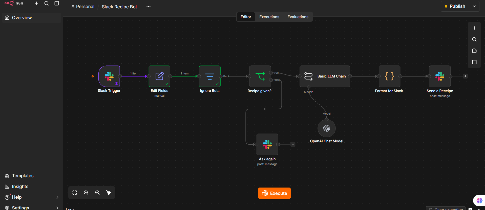

# Slack Recipe Bot – n8n Automation (Assignment 8)

A user types a recipe name in a Slack channel; an AI (OpenAI gpt-5.4-mini) lists the
ingredients needed, and the bot replies in the same channel.

## Workflow
Slack Trigger → Edit Fields → Ignore Bots (Filter) → Recipe given? (IF)
→ Basic LLM Chain + OpenAI Chat Model → Format for Slack (Code) → Send Recipe (Slack)
IF false → Ask Again (Slack)

## Features
- Replies in the same Slack channel the question came from
- Ignores the bot's own messages (prevents reply loops)
- Empty message → asks the user to type a recipe
- Unrecognised recipe → asks the user to rephrase

## Setup
1. Import `slack-recipe-bot.json` into n8n (Workflows → Import from File).
2. Create a Slack app with bot scopes: channels:history, channels:read, chat:write,
   groups:history, groups:read, users:read. Install it and invite it to your channel.
3. In n8n, add a Slack API credential (Bot token + Signing Secret) and an OpenAI credential.
4. Select your channel in the Slack Trigger, activate the workflow, and paste the
   Production webhook URL into Slack → Event Subscriptions (bot event: message.channels).

No API keys or tokens are stored in this repository.
